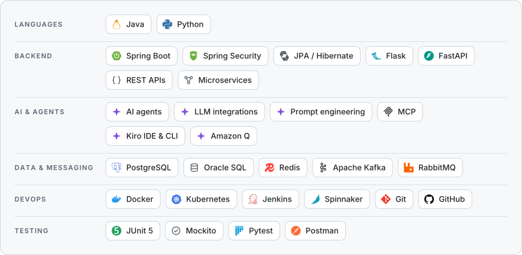

<!-- profile:header:start (generated from scripts/profile.toml, edit that file instead) -->

<a href="https://harishankar-github.github.io/"><picture>
  <source media="(max-width: 1011px)" srcset="assets/header-narrow.svg">
  
</picture></a>

&nbsp;
&nbsp;
&nbsp;
&nbsp;

<!-- profile:header:end -->

## 👋 About me

I've been building backend systems since 2018, across payments, healthcare and marketing tech, and now telecom at **Ericsson** in Ireland. My core is Java and Spring Boot microservices, Python services, and event-driven systems on Kafka and RabbitMQ.

Lately I'm just as focused on **AI agents**: putting LLMs, the Model Context Protocol (MCP) and solid prompt engineering to practical use in everyday developer workflows, from automated code review to MCP-powered tools.

🎓 **Education:** B.E. Computer Science & Engineering, Panimalar Institute of Technology (Anna University, Chennai, India), 2018

## 🧭 Career

<!-- profile:career:start (generated from scripts/profile.toml, edit that file instead) -->
<picture>
  <source media="(max-width: 1011px)" srcset="assets/career-narrow.svg">
  <source media="(prefers-color-scheme: dark)" srcset="assets/career-dark.svg">
  
</picture>
<!-- profile:career:end -->

## 🛠️ Tech stack

<!-- profile:stack:start (generated from scripts/profile.toml, edit that file instead) -->
<picture>
  <source media="(max-width: 1011px)" srcset="assets/stack-narrow.svg">
  <source media="(prefers-color-scheme: dark)" srcset="assets/stack-dark.svg">
  
</picture>
<!-- profile:stack:end -->

---

**Always happy to talk backend architecture, Spring Boot or AI agents.** 
[Connect on LinkedIn](https://www.linkedin.com/in/Harishankar97) · [Visit my portfolio](https://harishankar-github.github.io/)

